# CHAPTER 3

# METHODOLOGY

## Research Approach

This study adopted the Agile methodology as the primary software development approach for the proposed CafeOS system. Agile was selected because the system required repeated planning, design, development, testing, and review across several connected modules, including the Customer PWA, POS application, Admin dashboard, Supabase database, Maya payment handling, Lalamove delivery support, and loyalty features. Instead of treating development as a single linear process, Agile allowed the researchers to refine the system through incremental improvements based on operational requirements and observed workflow needs at Jayd's Cafe.

Figure 2
Agile Methodology Diagram

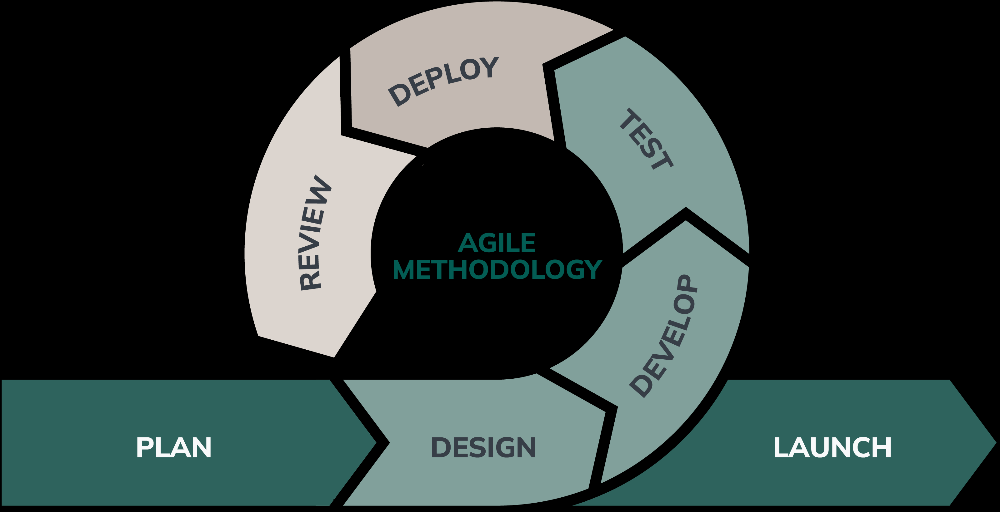

Figure 2 shows the Agile methodology used in the development of CafeOS. The process begins with the planning stage, where the researchers identified the existing ordering problems, user roles, required modules, and technical resources needed for the system. The design stage followed by preparing the system architecture, database structure, interface layout, and process flow of the Customer, POS, and Admin applications. After the design was established, the development stage focused on building the core features of the system, including menu browsing, order placement, POS order handling, loyalty points, vouchers, pickup confirmation, delivery handling, and administrative monitoring.

The testing stage was conducted to verify whether the developed features worked according to their intended functions. This included checking order creation, payment handling, QR-based account and pickup confirmation flows, inventory-related behavior, role-based access, and the integration points for Maya and Lalamove. After testing, the deployment stage prepared the applications for actual browser-based use through cloud-hosted services and shared backend infrastructure. The review stage allowed the researchers to evaluate completed features, identify needed revisions, and improve the system based on feedback and implementation findings. Finally, the launch stage represents the prepared system output that can be presented, evaluated, and used within the operational context of Jayd's Cafe.

## Requirement Analysis

Requirement analysis for CafeOS began by examining the existing ordering and service process of Jayd's Cafe. The researchers identified how customers currently move from arrival, queueing, manual order-taking, payment, loyalty stamping, preparation, and final serving. This process was analyzed to determine the operational issues that the proposed system should address, particularly queue congestion, unclear stock visibility, payment delays, manual order relay errors, and the limitations of physical loyalty cards.

Figure 3
Current Process Flowchart of Jayd's Cafe

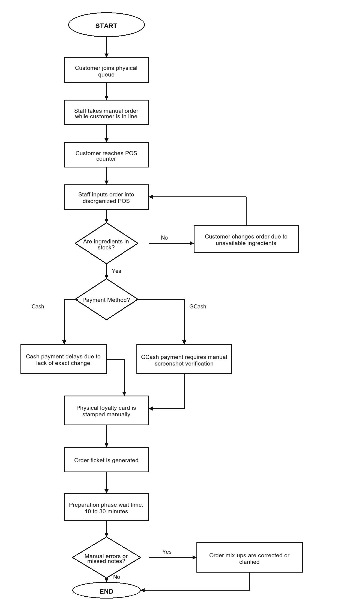

Figure 3 illustrates the current process followed by Jayd's Cafe before the implementation of CafeOS. The process begins when the customer arrives and joins the physical queue. Staff may manually take the order while the customer is waiting, after which the customer reaches the POS counter and the order is encoded into the existing POS workflow. If an ingredient is unavailable, the customer must change the order, causing the transaction to return to the order input stage and delaying the queue.

After the order is accepted, the customer proceeds to payment. Cash payments may cause delays when exact change is unavailable, while GCash payments require manual screenshot verification. The loyalty process also depends on manual physical card stamping, which is vulnerable to loss, inconsistency, and misuse. Once the order ticket is generated, the preparation phase may take around 10 to 30 minutes depending on order volume. Manual relay errors or missed notes may still cause order mix-ups, especially with temperature choices and customization requests. These issues became the basis for identifying the functional requirements of the proposed CafeOS system.

Figure 4
Use Case Diagram of the Proposed CafeOS System

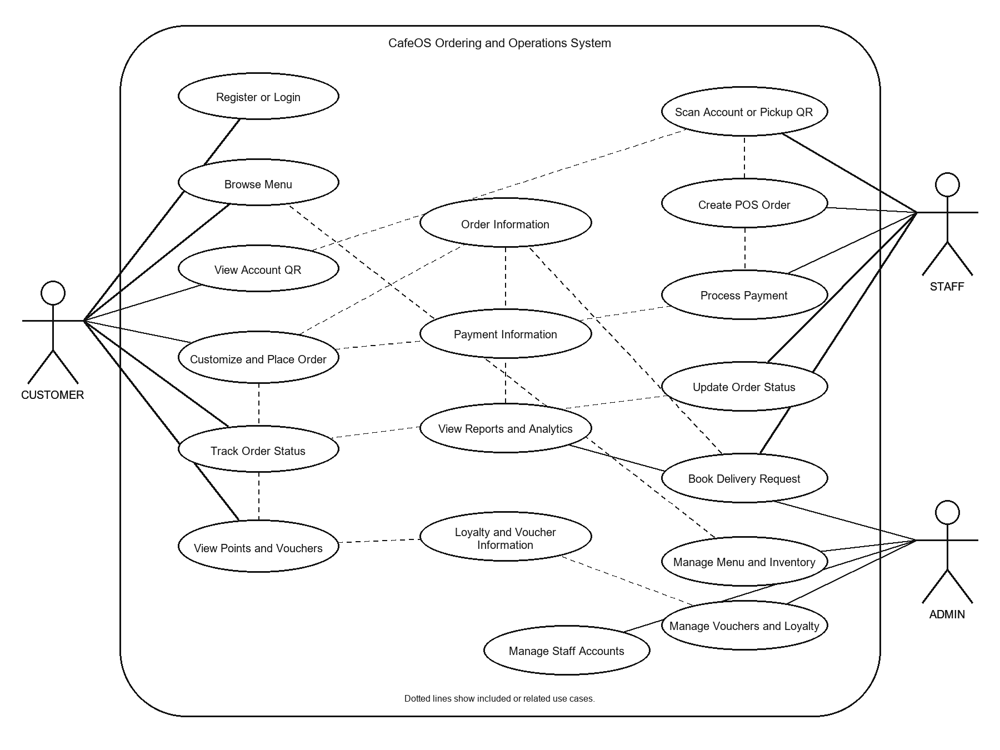

Figure 4 presents the use case diagram of the proposed CafeOS system. The diagram identifies three main actors: Customer, Staff, and Admin. The Customer actor interacts with the system by registering or logging in, browsing the menu, viewing the account QR, customizing an order, placing a pickup or delivery order, tracking order status, and viewing points and vouchers. These functions represent the customer-facing side of the Progressive Web App and show how the system supports ordering convenience and loyalty access.

The Staff actor represents POS and branch personnel who process orders inside the cafe. Staff use cases include scanning Account QR or pickup QR codes, creating POS orders, processing payments, updating order status, and booking delivery requests. The Admin actor represents management users who maintain the system by managing menu and inventory records, managing vouchers and loyalty settings, managing staff accounts, and viewing reports and analytics. The dotted relationships in the diagram indicate related use cases that are included or extended by another function, such as order placement including payment information, customer rewards connecting to loyalty information, or POS order creation optionally including QR scanning.

Figure 5
Context Diagram of the Proposed CafeOS System

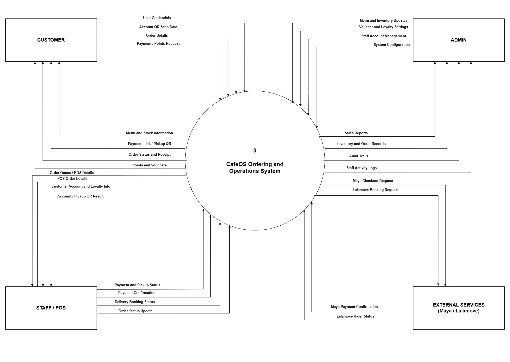

Figure 5 presents the context diagram of the proposed CafeOS system. The central process represents the entire CafeOS Ordering and Operations System, while the surrounding external entities represent the users and services that exchange data with the system. The Customer provides credentials, account QR information, order details, payment choices, points usage, and delivery information. In return, the system provides menu and stock information, payment links or pickup QR status, order status, receipts, points, and vouchers.

The Staff/POS entity sends POS order details, QR scan results, payment confirmations, and order status updates to the system. The system returns order queue information, KDS details, customer loyalty information, pickup status, payment status, and delivery booking status for branch operations. The Admin entity provides menu, inventory, voucher, loyalty, staff account, and system configuration updates, while receiving reports, inventory records, audit trails, and staff activity logs. The External Services entity represents the Maya and Lalamove integrations, where the system sends checkout and delivery booking requests and receives payment confirmations, rider status, and tracking-related updates.

Figure 6
Data Flow Diagram Level 1 - Customer Perspective

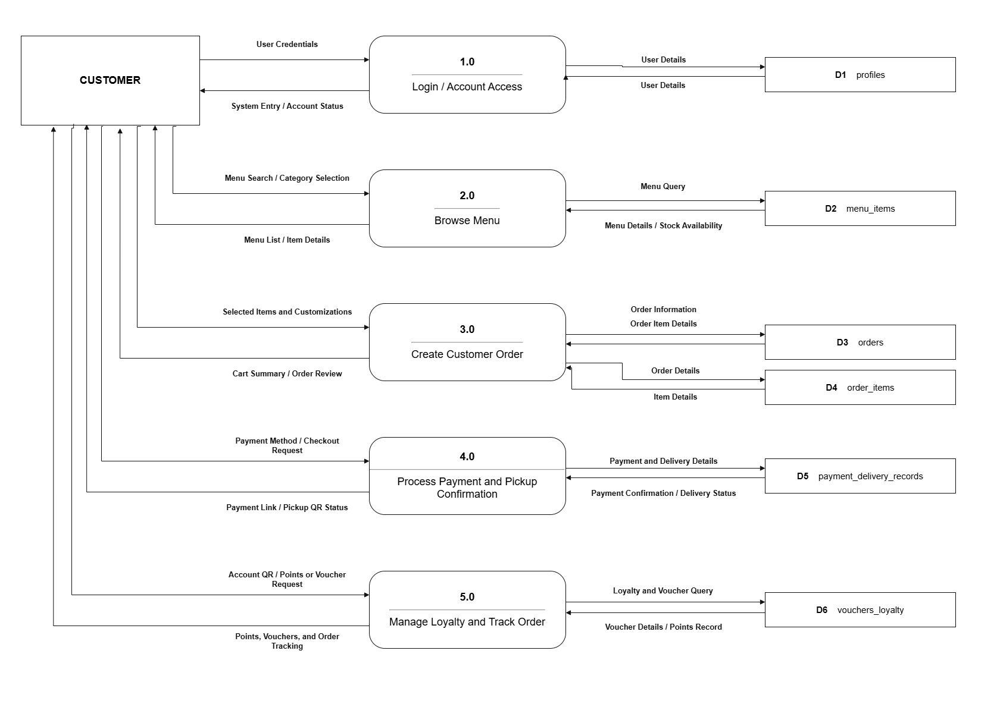

Figure 6 presents the Level 1 data flow diagram from the customer perspective. It shows how a customer registers or logs in, browses menu and stock details, places pickup or delivery orders, submits payment or pickup confirmation information, and receives order status, receipt, points, and voucher information from the system. The related data stores include customer profiles, menu records, order records, order item records, payment records, voucher and loyalty records, and saved address records.

Figure 7
Data Flow Diagram Level 1 - Staff/POS Perspective

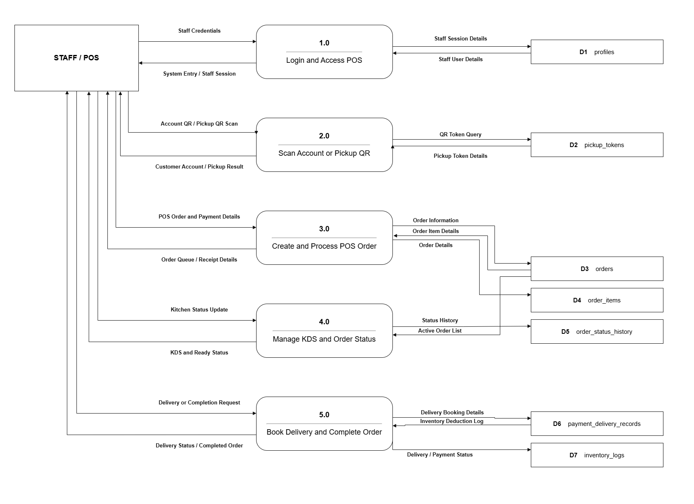

Figure 7 presents the Level 1 data flow diagram from the Staff/POS perspective. It shows how staff users access the POS, scan Account QR or pickup QR codes, create and process POS orders, update kitchen display and order status, and complete pickup or delivery-related transactions. The data stores used in this flow include user profiles, pickup tokens, orders, order items, order status history, payment or delivery records, and inventory logs.

Figure 8
Data Flow Diagram Level 1 - Admin Perspective

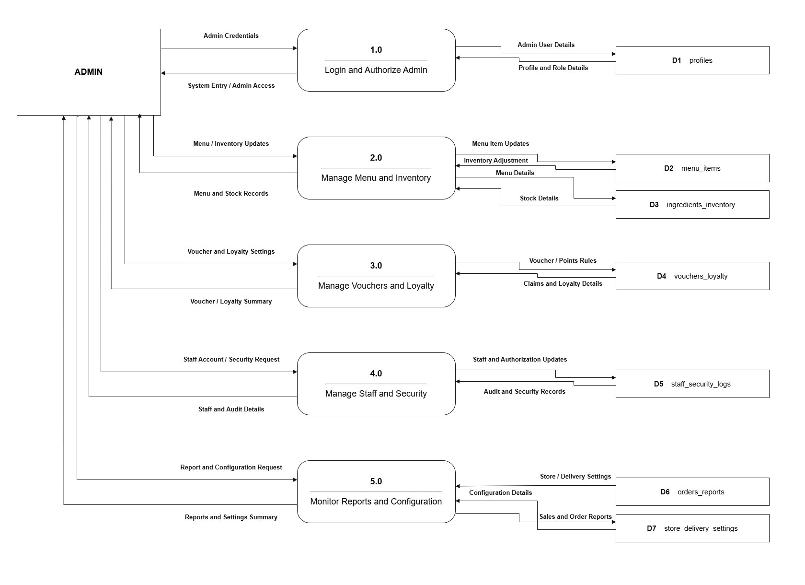

Figure 8 presents the Level 1 data flow diagram from the admin perspective. It shows how administrators authenticate, manage menu and inventory data, configure vouchers and loyalty rules, maintain staff accounts and security controls, and monitor reports and system settings. The related data stores include profiles, menu items, inventory records, voucher and loyalty records, staff security logs, order reports, and store or delivery settings.

Figure 9
Proposed System Flowchart of the CafeOS System Part 1

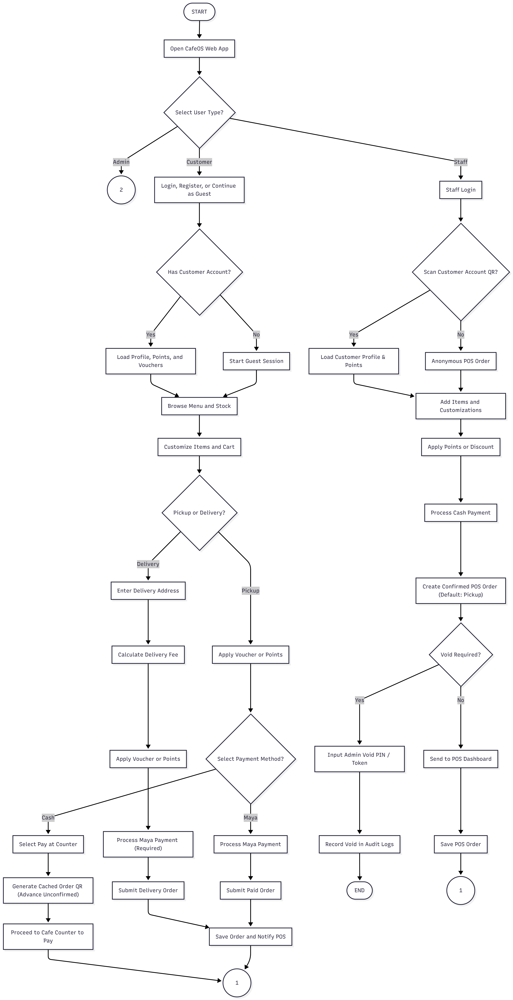

Figure 9 shows the first part of the proposed CafeOS system flowchart. This part presents the beginning of the system process, including user access, customer ordering, POS order creation, QR-based account handling, points or discount use, pickup or delivery selection, and the submission of the order into the system workflow.

Figure 10
Proposed System Flowchart of the CafeOS System Part 2

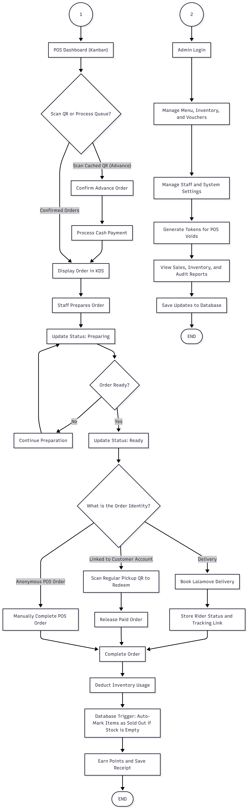

Figure 10 shows the continuation of the proposed CafeOS system flowchart. This part presents how submitted orders move through POS and kitchen display processing, order preparation, delivery or pickup release, inventory deduction, receipt saving, and administrative maintenance activities such as menu, inventory, voucher, staff, and report management.

## System Design

This section presents the primary system design figures and the data, software, hardware, and programming environment tables used for the development of the proposed CafeOS system. The figures and tables are arranged in the same manuscript style as the reference Chapter 3 document, where each item is labeled first and followed by the specific title and supporting explanation.

### Forms and Reports

Figure 11
Customer Registration Form

Figure 12
Customer Login Form

Figure 13
Customer Checkout Form

Figure 14
Customer Order Confirmation Form

Figure 15
Customer Orders Report

Figure 16
Customer Order Details Report

Figure 17
Customer Account QR Form

Figure 18
Customer Edit Profile Form

Figure 19
Customer Loyalty Report

Figure 20
Customer Voucher Report

Figure 21
Customer Saved Address Form

Figure 22
Staff/POS Login Form

Figure 23
Staff/POS Order Dashboard Report

Figure 24
Staff/POS Order Menu Form

Figure 25
Kitchen Display System Report

Figure 26
Admin Login Form

Figure 27
Admin Dashboard Report

Figure 28
Admin Orders Report

Figure 29
Admin Order Details Report

Figure 30
Admin Menu Items Report

Figure 31
Admin Menu Item Form

Figure 32
Admin Categories Report

Figure 33
Admin Category Options Form

Figure 34
Admin Inventory Report

Figure 35
Admin Inventory Material Form

Figure 36
Admin Voucher Management Report

Figure 37
Admin User Loyalty Report

Figure 38
Admin Staff Management Report

Figure 39
Admin Analytics Report

Figure 40
Admin Analytics Overview Report

Figure 41
Admin Revenue Over Time Report

Figure 42
Admin Best Sellers Report

Figure 43
Admin Sales Breakdown Report

Figure 44
Admin Peak Hours Heatmap Report

Figure 45
Admin Profit Margin Per Item Report

Figure 46
Admin Void Authorization Form

Figures 11 through 46 illustrate the main forms and reports of the proposed CafeOS system. These figures focus only on the screens that capture user input or present organized system records. The customer-side figures include registration, login, checkout, order confirmation, order records, account QR, profile, loyalty, voucher, and saved-address forms or reports. The staff and POS figures show branch login, order monitoring, POS order creation, and kitchen display reporting. The admin figures show management reports and maintenance forms for orders, menu items, categories, inventory, vouchers, loyalty users, staff accounts, analytics, sales summaries, peak-hour heatmaps, item profitability, and void authorization. Together, these forms and reports present the core input and output interfaces used by the three primary user groups of the system.
### Entity Relationship Diagrams

Figure 47
User Management and Profiles Module Entity Relationship Diagram

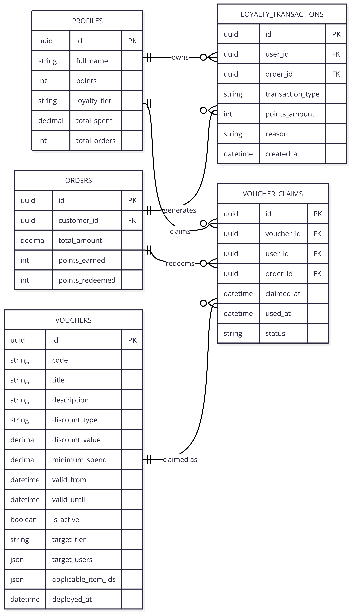

Figure 47 presents the entity relationship diagram for the User Management and Profiles module. This module connects Supabase authentication records with the CafeOS profiles table and related customer or staff information such as saved addresses, staff sessions, voucher claims, and orders connected to a user profile.

Figure 48
Menu and Catalog Module Entity Relationship Diagram

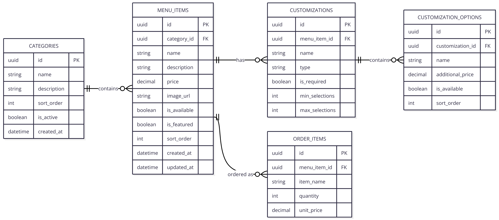

Figure 48 presents the entity relationship diagram for the Menu and Catalog module. This module shows how product categories, menu items, customizations, customization options, and order items are related to support menu browsing, item selection, and customized order creation.

Figure 49
Inventory and Supply Chain Module Entity Relationship Diagram

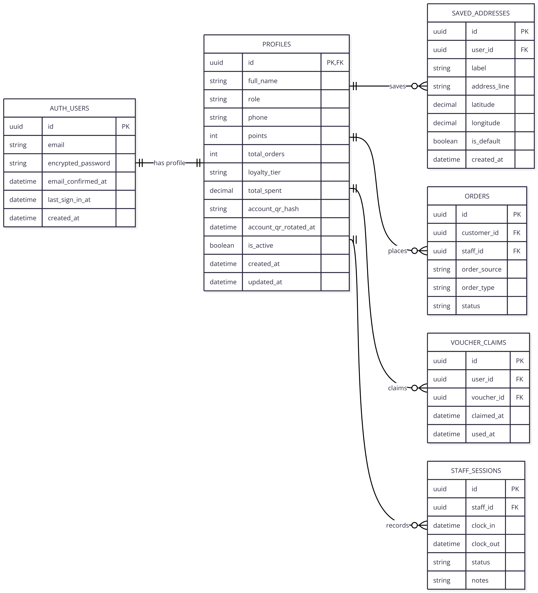

Figure 49 presents the entity relationship diagram for the Inventory and Supply Chain module. This module shows the relationship between menu ingredients, menu items, customization options, variant ingredient requirements, inventory logs, suppliers, and staff profiles responsible for inventory-related changes.

Figure 50
Order and Transaction Module Entity Relationship Diagram

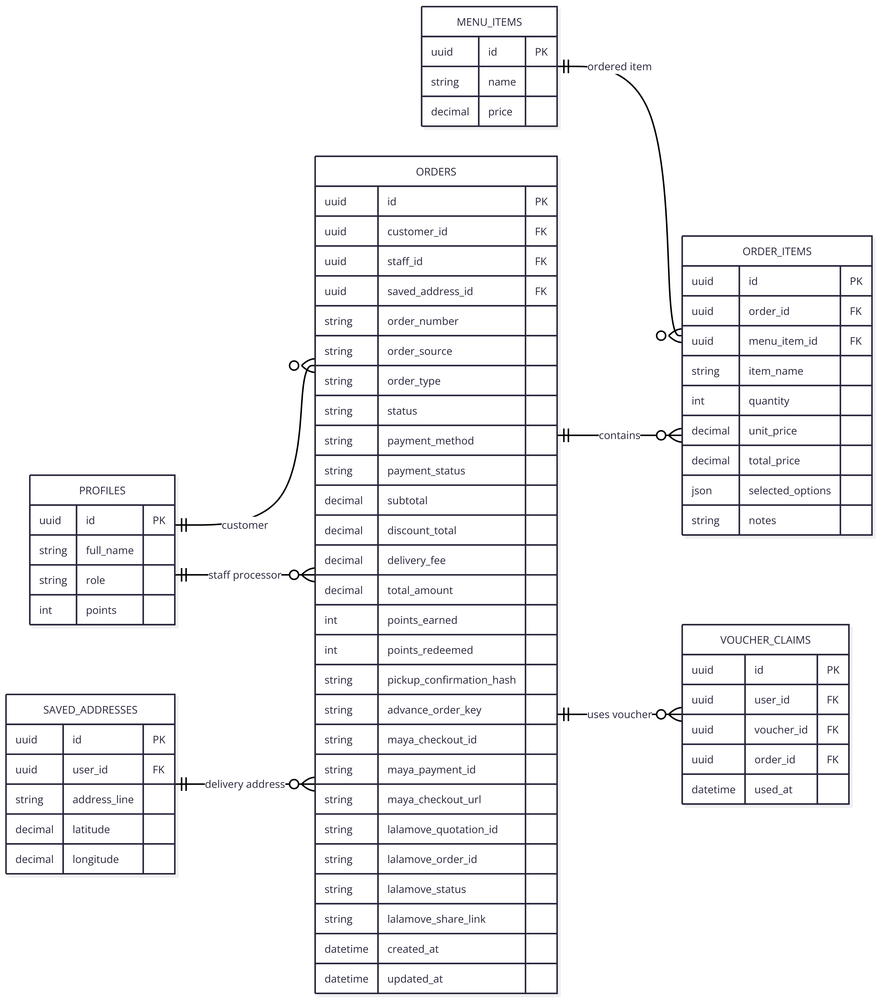

Figure 50 presents the entity relationship diagram for the Order and Transaction module. This module centers on the orders table and its relationship with customer profiles, staff profiles, saved addresses, ordered menu items, order item records, and voucher claims used during a transaction.

Figure 51
Loyalty and Promotions Module Entity Relationship Diagram

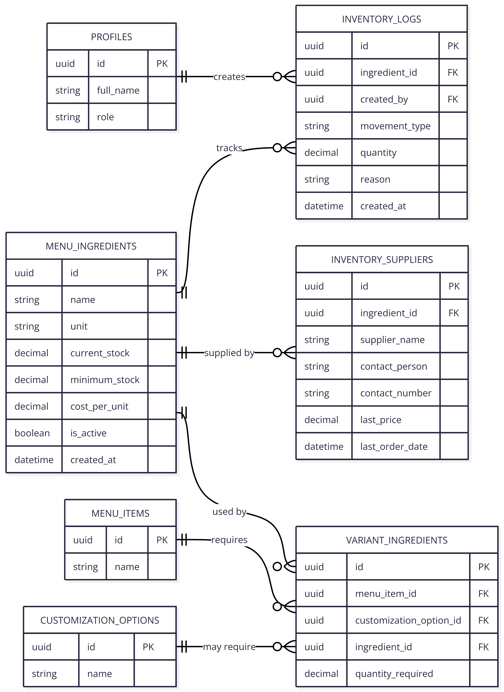

Figure 51 presents the entity relationship diagram for the Loyalty and Promotions module. This module shows how customer profiles, vouchers, voucher claims, loyalty transactions, orders, menu items, and eligible customization options are connected to support points, rewards, and promotional discounts.

Figure 52
Security and Authorization Module Entity Relationship Diagram

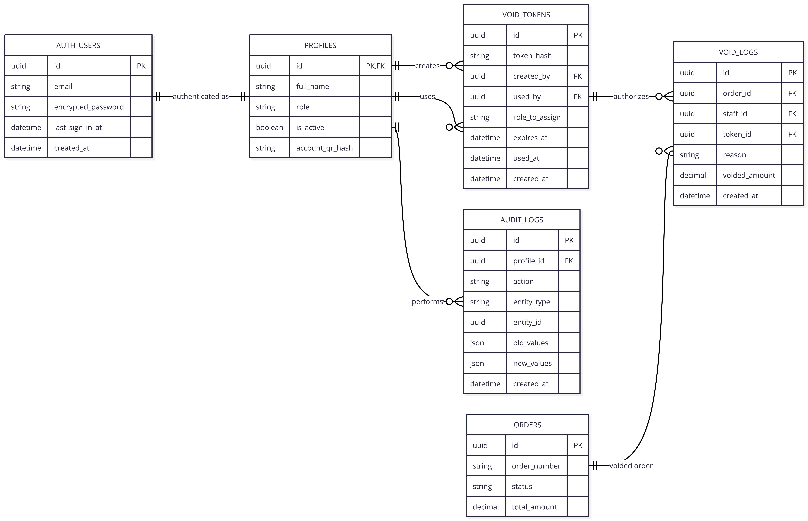

Figure 52 presents the entity relationship diagram for the Security and Authorization module. This module shows the relationship between authentication users, profiles, staff sessions, audit logs, void tokens, void logs, and orders that require authorized staff or administrative action.

Figure 53
System Configuration Module Entity Relationship Diagram

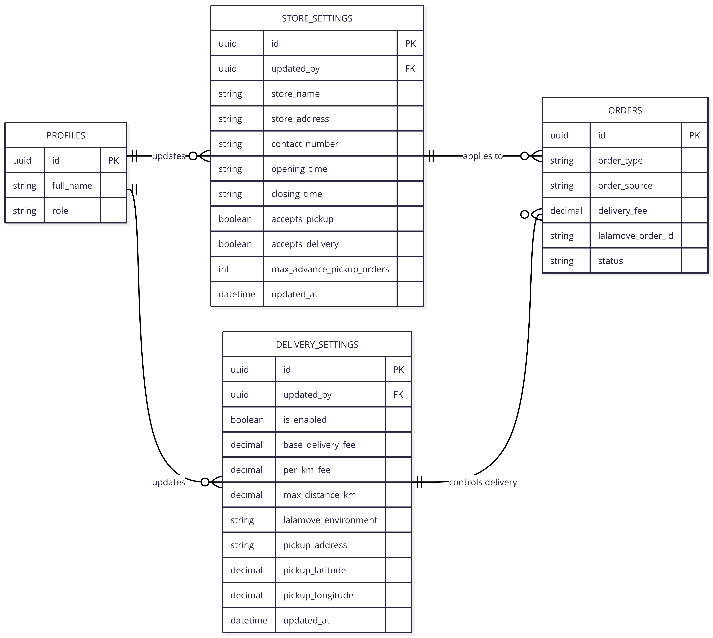

Figure 53 presents the entity relationship diagram for the System Configuration module. This module shows how store settings and delivery settings are maintained in relation to profiles and operational orders, allowing the system to apply branch-level configuration, delivery rules, and administrative settings.

Table 2
Data Dictionary

The data dictionary defines the major database tables, fields, constraints, and descriptions used by the proposed CafeOS system. Since the Customer PWA, POS application, and Admin dashboard share one Supabase backend, these tables support the common data requirements for ordering, payment handling, loyalty, pickup, delivery, inventory monitoring, and administrative operations.

### Profiles Table

| Column | Type | Constraints | Description |
| --- | --- | --- | --- |
| `id` | uuid | Primary Key, Foreign Key to `auth.users.id` | Unique identifier of the user profile. |
| `email` | text | Not Null | Email address connected to the Supabase Auth account. |
| `full_name` | text | Nullable | Full display name of the customer, staff, or administrator. |
| `role` | user_role | Not Null, Default `customer` | Determines access level: customer, staff, or admin. |
| `avatar_url` | text | Nullable | Optional profile image URL. |
| `phone` | text | Nullable | Contact number of the user. |
| `points` | integer | Not Null, Default `0` | Current loyalty points balance. |
| `total_orders` | integer | Not Null, Default `0` | Total completed orders credited to the user. |
| `last_check_in` | date | Nullable | Last recorded customer check-in date. |
| `loyalty_tier` | text | Not Null, Default `Bronze` | Current loyalty level of the customer. |
| `total_spent` | numeric | Not Null, Default `0` | Total purchase value accumulated by the customer. |
| `favorite_items` | uuid[] | Default empty array | List of menu item IDs marked as favorites. |
| `last_order_at` | timestamptz | Nullable | Date and time of the user's latest order. |
| `account_qr_hash` | text | Not Null, Unique | Secure hash used for the Account QR scanned at the branch POS. |
| `created_at` | timestamptz | Not Null, Default `now()` | Date and time when the profile was created. |
| `updated_at` | timestamptz | Not Null, Default `now()` | Date and time when the profile was last updated. |

### Loyalty Tiers Table

| Column | Type | Constraints | Description |
| --- | --- | --- | --- |
| `id` | uuid | Primary Key, Default `gen_random_uuid()` | Unique identifier of the loyalty tier. |
| `name` | text | Not Null, Unique | Display name of the loyalty tier. |
| `min_points` | integer | Not Null, Default `0` | Minimum points required to reach the tier. |
| `color` | text | Not Null, Default color value | Color used to represent the tier in the interface. |
| `perks` | jsonb | Not Null, Default empty array | Structured list of tier benefits. |
| `badge_emoji` | text | Not Null | Badge marker displayed for the tier. |
| `created_at` | timestamptz | Default `now()` | Date and time when the tier was created. |

### Saved Addresses Table

| Column | Type | Constraints | Description |
| --- | --- | --- | --- |
| `id` | uuid | Primary Key, Default `gen_random_uuid()` | Unique identifier of the saved address. |
| `user_id` | uuid | Not Null, Foreign Key to `auth.users.id` | User who owns the saved address. |
| `label` | text | Not Null, Default `Home` | User-defined address label. |
| `address` | text | Not Null | Full delivery address. |
| `lat` | numeric(10,7) | Not Null | Latitude coordinate of the delivery address. |
| `lng` | numeric(10,7) | Not Null | Longitude coordinate of the delivery address. |
| `created_at` | timestamptz | Default `now()` | Date and time when the address was saved. |

### Categories Table

| Column | Type | Constraints | Description |
| --- | --- | --- | --- |
| `id` | uuid | Primary Key, Default `gen_random_uuid()` | Unique identifier of the menu category. |
| `name` | text | Not Null, Unique | Name of the category such as drinks, food, or pastries. |
| `description` | text | Nullable | Optional description of the category. |
| `sort_order` | integer | Not Null, Default `0` | Display order of the category. |
| `is_active` | boolean | Not Null, Default `true` | Indicates whether the category is visible for use. |
| `status` | item_status | Not Null, Default `active` | Archive status of the category. |
| `created_at` | timestamptz | Not Null, Default `now()` | Date and time when the category was created. |
| `updated_at` | timestamptz | Not Null, Default `now()` | Date and time when the category was last updated. |

### Menu Items Table

| Column | Type | Constraints | Description |
| --- | --- | --- | --- |
| `id` | uuid | Primary Key, Default `gen_random_uuid()` | Unique identifier of the menu item. |
| `category_id` | uuid | Nullable, Foreign Key to `categories.id` | Category where the menu item belongs. |
| `name` | text | Not Null | Display name of the menu item. |
| `description` | text | Nullable | Product description shown to users. |
| `price` | decimal(10,2) | Not Null, Check `price >= 0` | Base selling price of the item. |
| `image_url` | text | Nullable | Image URL used in the menu interface. |
| `is_available` | boolean | Not Null, Default `true` | Indicates whether the item can currently be ordered. |
| `is_featured` | boolean | Not Null, Default `false` | Marks the item as featured in customer-facing views. |
| `prep_time_minutes` | integer | Not Null, Default `10` | Estimated preparation time. |
| `sort_order` | integer | Not Null, Default `0` | Display sequence within the menu. |
| `tags` | text[] | Default empty array | Classification tags used for filtering or display. |
| `status` | item_status | Not Null, Default `active` | Archive status of the menu item. |
| `recipe_required` | boolean | Not Null, Default `true` | Indicates whether inventory recipe deduction is required. |
| `created_at` | timestamptz | Not Null, Default `now()` | Date and time when the item was created. |
| `updated_at` | timestamptz | Not Null, Default `now()` | Date and time when the item was last updated. |

### Item Variants Table

| Column | Type | Constraints | Description |
| --- | --- | --- | --- |
| `id` | uuid | Primary Key, Default `gen_random_uuid()` | Unique identifier of the item variant. |
| `menu_item_id` | uuid | Not Null, Foreign Key to `menu_items.id` | Menu item connected to the variant. |
| `variant_group` | text | Not Null | Group name such as size, temperature, or sugar level. |
| `label` | text | Not Null | Display label of the variant option. |
| `price_modifier` | decimal(10,2) | Not Null, Default `0` | Additional price applied when selected. |
| `is_default` | boolean | Not Null, Default `false` | Indicates whether the option is selected by default. |
| `sort_order` | integer | Not Null, Default `0` | Display order of the variant. |
| `applicable_items` | jsonb | Nullable | JSON rule defining which items may use the option. |
| `created_at` | timestamptz | Not Null, Default `now()` | Date and time when the variant was created. |

### Ingredients Table

| Column | Type | Constraints | Description |
| --- | --- | --- | --- |
| `id` | uuid | Primary Key, Default `gen_random_uuid()` | Unique identifier of the inventory ingredient. |
| `name` | text | Not Null, Unique | Name of the ingredient or raw material. |
| `unit` | text | Not Null, Default `g` | Unit of measurement. |
| `current_stock` | numeric | Not Null, Default `0` | Current available stock quantity. |
| `min_stock_alert` | numeric | Not Null, Default `50` | Threshold for low-stock monitoring. |
| `cost_per_unit` | numeric | Not Null, Default `0` | Cost per unit used for stock valuation. |
| `supplier` | text | Nullable | Supplier name or reference. |
| `is_active` | boolean | Not Null, Default `true` | Indicates whether the ingredient is active. |
| `created_at` | timestamptz | Default `now()` | Date and time when the ingredient was created. |
| `updated_at` | timestamptz | Default `now()` | Date and time when the ingredient was last updated. |

### Menu Item Ingredients Table

| Column | Type | Constraints | Description |
| --- | --- | --- | --- |
| `id` | uuid | Primary Key, Default `gen_random_uuid()` | Unique identifier of the recipe mapping. |
| `menu_item_id` | uuid | Not Null, Foreign Key to `menu_items.id` | Menu item that consumes the ingredient. |
| `ingredient_id` | uuid | Not Null, Foreign Key to `ingredients.id` | Ingredient consumed by the menu item. |
| `quantity_used` | numeric | Not Null, Default `1` | Quantity deducted for the base recipe. |
| `size_multipliers` | jsonb | Not Null | JSON values used to adjust ingredient usage by size. |

### Variant Ingredients Table

| Column | Type | Constraints | Description |
| --- | --- | --- | --- |
| `id` | uuid | Primary Key, Default `gen_random_uuid()` | Unique identifier of the variant ingredient rule. |
| `variant_label` | text | Not Null | Variant option label that affects ingredient use. |
| `variant_group` | text | Not Null | Variant group connected to the rule. |
| `ingredient_id` | uuid | Not Null, Foreign Key to `ingredients.id` | Ingredient added or affected by the variant. |
| `quantity_used` | numeric | Not Null, Default `1` | Quantity added or deducted because of the variant. |
| `replaces_ingredient_id` | uuid | Nullable, Foreign Key to `ingredients.id` | Ingredient replaced by the selected variant, if applicable. |

### Inventory Logs Table

| Column | Type | Constraints | Description |
| --- | --- | --- | --- |
| `id` | uuid | Primary Key, Default `gen_random_uuid()` | Unique identifier of the inventory log. |
| `ingredient_id` | uuid | Not Null, Foreign Key to `ingredients.id` | Ingredient affected by the stock movement. |
| `change_amount` | numeric | Not Null | Amount added or deducted. |
| `change_type` | text | Not Null, Default `manual_adjustment` | Reason or classification of the stock change. |
| `order_id` | uuid | Nullable, Foreign Key to `orders.id` | Order associated with the stock movement, if any. |
| `staff_id` | uuid | Nullable, Foreign Key to `profiles.id` | Staff user who recorded or caused the movement. |
| `notes` | text | Nullable | Additional explanation of the adjustment. |
| `stock_after` | numeric | Not Null, Default `0` | Remaining stock after the change. |
| `created_at` | timestamptz | Default `now()` | Date and time when the log was recorded. |

### Orders Table

| Column | Type | Constraints | Description |
| --- | --- | --- | --- |
| `id` | uuid | Primary Key, Default `gen_random_uuid()` | Unique identifier of the order. |
| `order_number` | text | Not Null, Unique | Human-readable order number generated by the system. |
| `customer_id` | uuid | Nullable, Foreign Key to `profiles.id` | Customer account connected to the order; null for guest orders. |
| `staff_id` | uuid | Nullable, Foreign Key to `profiles.id` | Staff account that processed the order in POS, if applicable. |
| `status` | order_status | Not Null, Default `pending` | Fulfillment status of the order. |
| `order_type` | order_type | Not Null, Default `dine_in` | Fulfillment mode such as dine-in, takeout, pickup, or delivery. |
| `order_source` | text | Not Null, Default `app` | Identifies whether the order came from the customer app or POS. |
| `payment_method` | payment_method | Not Null, Default `cash` | Payment method such as cash or Maya. |
| `payment_status` | payment_status | Not Null, Default `pending` | Payment state such as pending, paid, failed, or refunded. |
| `subtotal` | decimal(10,2) | Not Null, Default `0` | Total amount before discounts, points, and delivery charges. |
| `discount` | numeric | Not Null, Default `0` | Discount amount applied to the order. |
| `total` | decimal(10,2) | Not Null, Default `0` | Final payable order amount. |
| `notes` | text | Nullable | Customer or staff notes for the order. |
| `maya_checkout_id` | text | Nullable | Maya checkout reference ID. |
| `maya_payment_id` | text | Nullable | Maya payment reference ID. |
| `maya_checkout_url` | text | Nullable | Checkout URL generated for Maya payment continuation. |
| `points_earned` | integer | Not Null, Default `0` | Loyalty points earned by the order. |
| `points_redeemed` | integer | Not Null, Default `0` | Loyalty points used as a deduction. |
| `delivery_address` | text | Nullable | Delivery destination address. |
| `delivery_fee` | numeric(10,2) | Default `0` | Delivery fee charged to the order. |
| `delivery_lat` | numeric(10,7) | Nullable | Delivery latitude coordinate. |
| `delivery_lng` | numeric(10,7) | Nullable | Delivery longitude coordinate. |
| `delivery_name` | text | Nullable | Name of the delivery recipient. |
| `delivery_phone` | text | Nullable | Contact number of the delivery recipient. |
| `lalamove_quotation_id` | text | Nullable | Lalamove quotation reference. |
| `lalamove_order_id` | text | Nullable | Lalamove booking reference. |
| `lalamove_status` | text | Nullable | Current delivery status from Lalamove. |
| `lalamove_share_link` | text | Nullable | Public tracking link for the delivery. |
| `expires_at` | timestamptz | Nullable | Expiration date and time for unpaid or unconfirmed orders. |
| `pickup_confirmation_hash` | text | Nullable | Secure hash for the payment confirmation QR used in advance pickup. |
| `advance_order_key` | text | Nullable | Key used to limit active advance pickup QR orders. |
| `created_at` | timestamptz | Not Null, Default `now()` | Date and time when the order was created. |
| `updated_at` | timestamptz | Not Null, Default `now()` | Date and time when the order was last updated. |

### Order Items Table

| Column | Type | Constraints | Description |
| --- | --- | --- | --- |
| `id` | uuid | Primary Key, Default `gen_random_uuid()` | Unique identifier of the line item. |
| `order_id` | uuid | Not Null, Foreign Key to `orders.id` | Parent order containing the item. |
| `menu_item_id` | uuid | Nullable, Foreign Key to `menu_items.id` | Menu item ordered by the customer. |
| `name` | text | Not Null | Snapshot name of the item at the time of order. |
| `price` | decimal(10,2) | Not Null | Unit price at the time of order. |
| `quantity` | integer | Not Null, Default `1`, Check `quantity > 0` | Quantity ordered. |
| `variants` | jsonb | Default empty array | Selected customization options. |
| `subtotal` | decimal(10,2) | Not Null | Line item subtotal. |
| `notes` | text | Nullable | Item-level notes or special instructions. |
| `created_at` | timestamptz | Not Null, Default `now()` | Date and time when the item was recorded. |

### Order Status History Table

| Column | Type | Constraints | Description |
| --- | --- | --- | --- |
| `id` | uuid | Primary Key, Default `gen_random_uuid()` | Unique identifier of the status history record. |
| `order_id` | uuid | Not Null, Foreign Key to `orders.id` | Order whose status changed. |
| `previous_status` | order_status | Nullable | Status before the change. |
| `new_status` | order_status | Not Null | Status after the change. |
| `changed_by` | uuid | Nullable, Foreign Key to `profiles.id` | User who performed the status update. |
| `notes` | text | Nullable | Optional note describing the change. |
| `created_at` | timestamptz | Not Null, Default `now()` | Date and time when the status change was logged. |

### Vouchers Table

| Column | Type | Constraints | Description |
| --- | --- | --- | --- |
| `id` | uuid | Primary Key, Default `gen_random_uuid()` | Unique identifier of the voucher. |
| `code` | text | Not Null, Unique | Voucher code used by customers. |
| `description` | text | Nullable | Description or internal note for the voucher. |
| `discount_type` | text | Not Null | Type of discount, such as percentage or fixed amount. |
| `discount_value` | decimal(10,2) | Not Null | Discount value applied by the voucher. |
| `min_order_amount` | decimal(10,2) | Default `0` | Minimum order amount required. |
| `max_uses` | integer | Nullable | Maximum number of voucher uses. |
| `uses_count` | integer | Default `0` | Current number of uses. |
| `valid_from` | timestamptz | Default `now()` | Start of voucher validity. |
| `valid_until` | timestamptz | Nullable | End of voucher validity. |
| `is_active` | boolean | Default `true` | Indicates whether the voucher is active. |
| `target_tier` | text | Nullable | Loyalty tier eligible for the voucher. |
| `target_users` | jsonb | Nullable | Specific users targeted by the voucher. |
| `frequency_limit` | integer | Nullable | Limit of uses per user or rule set. |
| `deployed_at` | timestamptz | Nullable | Date and time when the voucher was deployed. |
| `applicable_item_ids` | jsonb | Default empty array | Menu items where the voucher may apply. |
| `application_mode` | text | Default `whole_order` | Whether the voucher applies to the whole order or selected items. |
| `max_discount_amount` | numeric | Nullable | Maximum discount cap for percentage-based vouchers. |
| `created_at` | timestamptz | Default `now()` | Date and time when the voucher was created. |

### Voucher Claims Table

| Column | Type | Constraints | Description |
| --- | --- | --- | --- |
| `id` | uuid | Primary Key, Default `gen_random_uuid()` | Unique identifier of the voucher claim. |
| `voucher_id` | uuid | Not Null, Foreign Key to `vouchers.id` | Voucher claimed by the customer. |
| `user_id` | uuid | Not Null, Foreign Key to `auth.users.id` | User who claimed the voucher. |
| `claimed_at` | timestamptz | Not Null, Default `now()` | Date and time when the voucher was claimed. |
| `expires_at` | timestamptz | Nullable | Expiration date and time of the claim. |
| `used_at` | timestamptz | Nullable | Date and time when the voucher was used. |
| `order_id` | uuid | Nullable, Foreign Key to `orders.id` | Order where the voucher was applied. |

### Notifications Table

| Column | Type | Constraints | Description |
| --- | --- | --- | --- |
| `id` | uuid | Primary Key, Default `gen_random_uuid()` | Unique identifier of the notification. |
| `user_id` | uuid | Nullable, Foreign Key to `auth.users.id` | User who receives the notification. |
| `title` | text | Not Null | Notification title. |
| `body` | text | Not Null | Notification message content. |
| `type` | notification_type | Not Null, Default `system` | Classification of the notification. |
| `is_read` | boolean | Not Null, Default `false` | Indicates whether the user has read the notification. |
| `data` | jsonb | Default empty object | Additional structured notification data. |
| `created_at` | timestamptz | Not Null, Default `now()` | Date and time when the notification was created. |

### Pickup Tokens Table

| Column | Type | Constraints | Description |
| --- | --- | --- | --- |
| `id` | uuid | Primary Key, Default `gen_random_uuid()` | Unique identifier of the pickup token. |
| `order_id` | uuid | Not Null, Foreign Key to `orders.id` | Order connected to the pickup token. |
| `token_hash` | text | Not Null, Unique | Hashed token used for pickup confirmation. |
| `is_used` | boolean | Not Null, Default `false` | Indicates whether the pickup token has already been consumed. |
| `created_at` | timestamptz | Default `now()` | Date and time when the pickup token was generated. |

### Guest Receipts Table

| Column | Type | Constraints | Description |
| --- | --- | --- | --- |
| `id` | uuid | Primary Key, Default `gen_random_uuid()` | Unique identifier of the guest receipt. |
| `order_id` | uuid | Not Null, Foreign Key to `orders.id` | Order connected to the guest receipt. |
| `receipt_token` | text | Not Null, Unique | Public token for viewing the guest receipt. |
| `receipt_data` | jsonb | Not Null, Default empty object | Snapshot data used for guest receipt display. |
| `created_at` | timestamptz | Default `now()` | Date and time when the receipt was created. |
| `expires_at` | timestamptz | Default `now() + 30 days` | Date and time when the guest receipt expires. |

### Clock Entries Table

| Column | Type | Constraints | Description |
| --- | --- | --- | --- |
| `id` | uuid | Primary Key, Default `gen_random_uuid()` | Unique identifier of the timekeeping record. |
| `staff_id` | uuid | Not Null, Foreign Key to `profiles.id` | Staff user connected to the clock entry. |
| `clock_in` | timestamptz | Not Null, Default `now()` | Date and time when the staff member clocked in. |
| `clock_out` | timestamptz | Nullable | Date and time when the staff member clocked out. |
| `total_hours` | numeric(6,2) | Nullable | Computed or stored total hours worked. |
| `notes` | text | Nullable | Optional staff or admin note. |
| `created_at` | timestamptz | Not Null, Default `now()` | Date and time when the clock entry was recorded. |

### Shifts Table

| Column | Type | Constraints | Description |
| --- | --- | --- | --- |
| `id` | uuid | Primary Key, Default `gen_random_uuid()` | Unique identifier of the staff shift. |
| `staff_id` | uuid | Not Null, Foreign Key to `profiles.id` | Staff user connected to the shift. |
| `clock_in` | timestamptz | Not Null, Default `now()` | Start time of the shift. |
| `clock_out` | timestamptz | Nullable | End time of the shift. |
| `duration_minutes` | numeric | Generated column | Computed shift duration in minutes. |
| `orders_handled` | integer | Not Null, Default `0` | Number of orders handled during the shift. |
| `total_sales` | numeric | Not Null, Default `0` | Sales total connected to the shift. |
| `notes` | text | Nullable | Optional notes for the shift. |
| `created_at` | timestamptz | Default `now()` | Date and time when the shift record was created. |

### Void Tokens Table

| Column | Type | Constraints | Description |
| --- | --- | --- | --- |
| `id` | uuid | Primary Key, Default `gen_random_uuid()` | Unique identifier of the void token. |
| `token_hash` | text | Not Null, Unique | Hashed token value used for void authorization where enabled. |
| `created_by` | uuid | Nullable, Foreign Key to `profiles.id` | Admin user who generated the token. |
| `used_by` | uuid | Nullable, Foreign Key to `profiles.id` | Staff user who consumed the token. |
| `used_at` | timestamptz | Nullable | Date and time when the token was used. |
| `order_id` | uuid | Nullable, Foreign Key to `orders.id` | Order associated with the void request. |
| `expires_at` | timestamptz | Not Null | Date and time when the token expires. |
| `is_used` | boolean | Not Null, Default `false` | Indicates whether the token has already been used. |
| `created_at` | timestamptz | Default `now()` | Date and time when the token was created. |

### Store Settings Table

| Column | Type | Constraints | Description |
| --- | --- | --- | --- |
| `id` | text | Primary Key, Default `global` | Identifier of the global store settings record. |
| `void_pin` | text | Not Null, Default `123456` | Manager PIN used to authorize void transactions. |
| `updated_at` | timestamptz | Default `now()` | Date and time when the store setting was last updated. |

### Void Logs Table

| Column | Type | Constraints | Description |
| --- | --- | --- | --- |
| `id` | uuid | Primary Key, Default `gen_random_uuid()` | Unique identifier of the void audit log. |
| `order_id` | uuid | Nullable, Foreign Key to `orders.id` | Order that was voided or cancelled. |
| `staff_id` | uuid | Nullable, Foreign Key to `profiles.id` | Staff user who performed the void action. |
| `created_at` | timestamptz | Default `now()` | Date and time when the void action was recorded. |

Table 2 provides a structured reference for the database used by CafeOS. It shows how customer accounts, menu information, order records, loyalty points, QR-based account and pickup confirmation flows, vouchers, staff actions, delivery references, and audit records are stored in the system. This data dictionary supports database consistency and ensures that the implemented tables align with the operational needs of Jayd's Cafe.

### System Architecture

CafeOS uses a cloud-native and serverless system architecture where the Customer PWA, POS application, and Admin dashboard communicate with shared backend services over the public internet. The frontend applications are hosted through Vercel, while Supabase provides authentication, PostgreSQL database storage, row-level security, and realtime communication. External services such as Maya and Lalamove are accessed through secured API requests handled by server-side routes.

Figure 54
TCP/IP Network Model of the CafeOS System

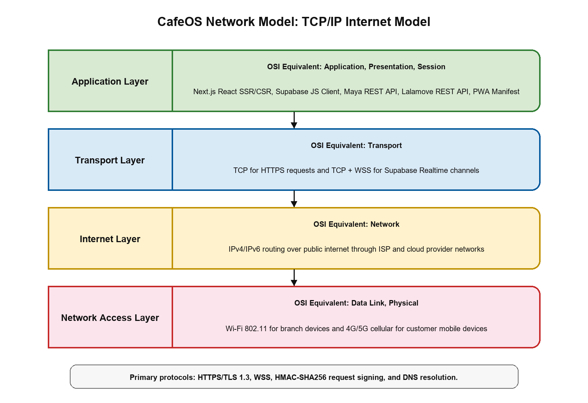

Figure 54 presents the TCP/IP network model applied to CafeOS. The application layer includes Next.js, the Supabase JavaScript client, Maya REST API, Lalamove REST API, and the PWA manifest. The transport layer uses TCP for HTTPS requests and WebSocket Secure connections for realtime order updates. The internet layer relies on IPv4 or IPv6 routing through internet and cloud provider networks, while the network access layer covers Wi-Fi connections for branch devices and mobile data connections for customer devices. This model reflects the network communication structure described in the CafeOS Network Topology and Network Model document.

Figure 55
Network Topology of the CafeOS System

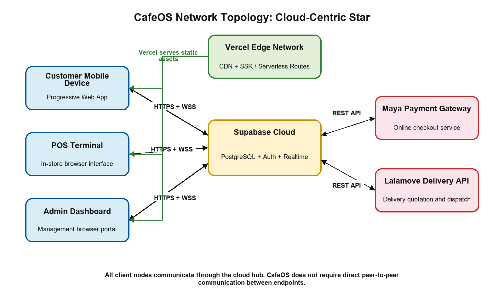

Figure 55 presents the cloud-centric star topology of CafeOS. In this topology, the Customer PWA, POS terminal, and Admin dashboard communicate with Supabase as the central cloud hub through HTTPS and WebSocket Secure connections. Vercel serves the frontend assets to the client applications, while Supabase and the server-side API routes connect to external services such as Maya and Lalamove through REST API communication. This topology avoids direct peer-to-peer communication between user devices and keeps database, authentication, realtime updates, payment, and delivery operations centralized through cloud services.

Figure 56
Deployment Diagram of the Proposed CafeOS System

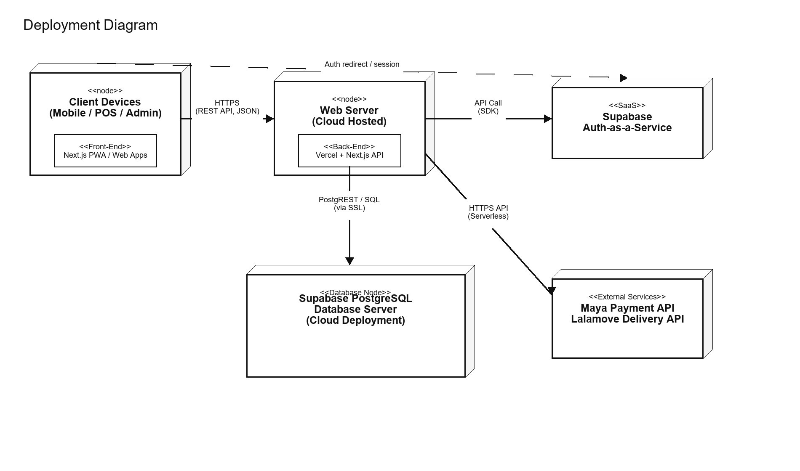

Figure 56 presents the deployment diagram of the proposed CafeOS system. The diagram shows the Customer mobile device, branch POS terminal, and Admin workstation accessing the CafeOS applications through web browsers over HTTPS. The applications are deployed as separate Vercel projects connected to the same monorepo, while serverless API routes handle secured backend operations that should not run directly on the client side.

The diagram also shows Supabase as the main backend cloud service for authentication, PostgreSQL database storage, row-level security, and realtime updates. Maya and Lalamove are represented as external services accessed through server-side API routes for payment checkout, payment confirmation, delivery quotation, booking, and rider status. This deployment structure supports the branch-based POS workflow, online customer ordering, centralized administration, and third-party service integration while keeping sensitive credentials and backend operations outside the browser.

Table 3
Software Specification

| Component | Specification | Description |
| --- | --- | --- |
| Development Operating System | Windows 11 | Primary operating system used to write, test, and run the project during development. |
| Web Runtime and Hosting | Node.js and Vercel Edge Network | Node.js supports the Next.js runtime, while Vercel hosts the deployed web applications and serverless API routes. |
| Programming Languages | TypeScript, JavaScript, HTML5, CSS3 | TypeScript and JavaScript implement the system logic, while HTML5 and CSS3 support page structure and styling. |
| Dependency Manager | npm | Manages external packages and workspace dependencies for the monorepo. |
| Database Management | Supabase and PostgreSQL 15+ | Supabase provides a managed PostgreSQL database, authentication, row-level security, realtime updates, and SQL management tools. |
| Development Tools | Visual Studio Code / Cursor | Integrated development environments used for coding, terminal access, extension support, and debugging. |
| Version Control | Git | Tracks source-code changes and supports branching and collaboration. |
| Repository Hosting | GitHub | Stores the project repository and supports integration with deployment workflows. |
| Local Development Server | Next.js Development Server | Runs the Customer, POS, and Admin applications on localhost during testing. |
| Web Browser | Chrome, Edge, Firefox, or Safari | Allows customers, staff, and administrators to access the web-based applications. |
| Payment Gateway | Maya Checkout API | Used for online checkout session generation and payment confirmation handling. |
| Delivery Gateway | Lalamove API | Used for delivery quotation, booking, and delivery status tracking. |

Table 3 shows the software requirements needed to develop, test, deploy, and access CafeOS. These software components support the system's web-based architecture, secure database operations, third-party payment handling, delivery integration, and browser-based accessibility for customers, POS staff, and administrators.

Table 4
Hardware Specification

| Component | Minimum Specification | Recommended Specification |
| --- | --- | --- |
| Device | Smartphone or basic tablet | Desktop or laptop for Admin, and iPad or modern Android tablet for POS |
| Processor | 1.5 GHz dual-core processor | 2.0 GHz quad-core processor or higher |
| Memory | 2 GB RAM | 4 GB RAM or higher |
| Storage | 1 GB available space for browser cache and PWA storage | 4 GB available space |
| Network | Stable 3G connection or 1 Mbps internet speed | 4G, Wi-Fi, or broadband connection with 5 Mbps or higher |
| Backup | Cloud-based automatic backup managed by Supabase | Daily automated cloud backup with Point-in-Time Recovery where available |

Table 4 presents the hardware requirements for running CafeOS. Since the system is a cloud-hosted Progressive Web App, the end-user hardware requirements remain lightweight. Customer phones, POS tablets, and admin computers only need a modern browser and stable internet connection, while heavier processing and data storage are handled by Vercel and Supabase.

## Programming Environment

Table 5
Proposed System Frontend

| Component | Version | How it will be used |
| --- | --- | --- |
| Next.js | 14.1.0 | Used as the main React framework for the Customer PWA, POS application, Admin dashboard, routing, rendering, and API endpoint structure. |
| React | 18.2.0 | Used to build reusable and interactive user interface components. |
| TypeScript | 5.3.3 | Used to add static typing, reduce runtime errors, and improve maintainability across the shared codebase. |
| Tailwind CSS | 3.4.1 | Used to create responsive and consistent interface styling. |
| next-pwa | 5.6.0 | Used to support Progressive Web App behavior such as installability and caching for the Customer application. |
| React Leaflet | 4.2.1 | Used for map-based delivery address selection and location handling in the Customer application. |
| Supabase JavaScript Client | 2.39.3 | Used by frontend applications to communicate with Supabase, manage sessions, read and write records, and receive realtime order updates. |

Table 5 identifies the frontend programming environment used in CafeOS. These technologies support the customer-facing ordering interface, POS operations screen, and admin dashboard while allowing the applications to share reusable components and typed data structures through the monorepo.

Table 6
Proposed System Backend

| Component | Version | How it will be used |
| --- | --- | --- |
| Node.js | 18.x / 20.x | Used as the JavaScript runtime for Next.js server-side logic and API routes. |
| Next.js Serverless API Routes | 14.1.0 | Used to execute trusted backend operations that should not run directly in the browser, including Maya and Lalamove requests. |
| Supabase | Cloud | Provides the managed backend service for database storage, authentication, realtime subscriptions, and security policies. |
| PostgreSQL | 15+ | Stores all relational data for users, orders, menu items, inventory, vouchers, loyalty, delivery references, and audit logs. |
| Supabase Auth | Cloud | Handles user registration, login, session management, and identity verification. |
| Row Level Security | PostgreSQL / Supabase | Enforces role-based and ownership-based access rules directly at the database layer. |
| Supabase SSR | 0.1.0 | Helps manage secure authentication cookies in server-side Next.js contexts. |
| Maya API | v1 Cloud API | Generates checkout sessions and supports online payment confirmation. |
| Lalamove API | v3 Cloud API | Generates delivery quotations, creates delivery bookings, and stores delivery tracking references. |

Table 6 presents the backend programming environment of the proposed CafeOS system. The backend combines managed Supabase services with trusted Next.js serverless API routes, allowing the system to process orders, protect sensitive operations, handle payment and delivery integrations, and broadcast real-time order updates to staff interfaces.

## Test Plan

To evaluate the proposed CafeOS system, the researchers will conduct a structured test plan covering the major quality assurance activities needed for the Customer PWA, POS application, Admin dashboard, shared Supabase backend, and third-party service integrations. Unit testing will verify individual functions and components such as form validation, order total computation, loyalty point deduction, voucher checking, QR token handling, and role-based route guards. Integration testing will confirm that connected modules exchange data correctly, including customer checkout to POS order queue, POS order updates to customer order status, Admin menu updates to customer menu display, inventory-related records to admin reports, and server-side API routes to Maya and Lalamove.

Functional testing will validate that the main features of the system operate according to the requirements identified by the researchers. These features include customer registration and login, menu browsing, cart and checkout, Maya payment confirmation QR, account QR scanning for points, pickup QR confirmation, advance pickup order limits, Lalamove delivery booking, POS order processing, kitchen display monitoring, admin menu and inventory management, voucher and loyalty management, analytics, reports, and void authorization. Security testing will be performed to check authentication, row-level security, staff access restrictions, admin-only operations, QR expiration behavior, and protection of sensitive API credentials. Performance and load testing will check whether the system remains responsive when several customers, POS users, and administrators access ordering and reporting functions at the same time.

System testing will evaluate the complete CafeOS workflow as one integrated system, while user acceptance testing will be conducted with representative users from the customer, staff/POS, and admin perspectives. The researchers will also review the deployment environment, browser compatibility, network stability, database connectivity, and external service behavior to confirm that the system can support both online ordering and branch-based operations.

## System Testing Procedure

The system testing procedure will begin with preparation of the testing environment, including the Customer PWA, POS application, Admin dashboard, Supabase database, authentication rules, seed records, and configured API credentials for payment and delivery testing. The researchers will first perform unit testing by checking individual forms, validation rules, computation logic, QR generation and scanning behavior, role checks, and reusable utility functions. Each component will be tested separately before being connected to the rest of the system.

After unit testing, integration testing will be performed by executing connected workflows across modules. The researchers will create customer pickup and delivery orders, verify that the records appear in the POS dashboard and KDS, update order statuses, check that customers receive the correct order status and receipt information, and confirm that admin reports reflect the transactions. Payment-related tests will include generating Maya checkout links, validating payment confirmation QR behavior, and confirming that unpaid, paid, and expired states are handled correctly. Delivery-related tests will include Lalamove quotation, booking request handling, rider status storage, and network-error handling.

Functional testing will be conducted by simulating real user tasks for each role. Customers will be tested through account creation, login, menu browsing, voucher and point usage, QR presentation, checkout, pickup, delivery, and order history. Staff/POS users will be tested through scanning account and pickup QR codes, creating branch orders, confirming payments, updating order stages, using the KDS, and voiding orders with authorization. Administrators will be tested through menu maintenance, category options, inventory records, voucher and loyalty settings, staff management, analytics review, and audit-related reports.

Security, reliability, and performance checks will then be performed. The researchers will test unauthorized page access, invalid QR tokens, expired payment confirmation links, role-restricted actions, and protected server-side operations. Reliability testing will check recovery from failed API calls, network interruptions, duplicate submissions, and invalid order states. Performance testing will simulate multiple ordering and dashboard activities to observe response time and realtime update behavior. Finally, the complete system will be evaluated through end-to-end testing and user acceptance testing, where representative users will perform actual workflows and provide feedback before final revisions.

## System Evaluation Procedure

The proposed CafeOS system will be evaluated using the ISO/IEC 25010 software quality model as a guide for measuring whether the system meets its intended purpose. The evaluation will focus on functional suitability, performance efficiency, compatibility, usability, reliability, security, maintainability, and portability. These characteristics are appropriate for CafeOS because the system must support online customer ordering, branch-based POS activity, administrative monitoring, secure account handling, realtime order updates, payment confirmation, delivery integration, and loyalty-related operations.

For functional suitability, the system will be evaluated based on whether the implemented modules completely support the required ordering, payment, pickup, delivery, loyalty, inventory, and reporting functions. Functional correctness will be checked by comparing computed totals, loyalty deductions, voucher discounts, payment states, delivery states, and order status transitions with the expected results. For usability, respondents will evaluate whether the customer, POS, and admin interfaces are understandable, easy to navigate, and appropriate for their intended users. Error prevention will also be considered through confirmation dialogs, validation messages, QR expiration handling, and restrictions on invalid order actions.

For reliability, the system will be evaluated according to its ability to maintain consistent records and recover from failed network requests, duplicate actions, external API errors, and interrupted user sessions. For security, the evaluation will consider authentication, authorization, row-level security, admin-only controls, staff permissions, audit logs, QR token behavior, and protection of sensitive integration credentials. For performance efficiency, the researchers will observe loading time, order submission response, dashboard updates, report generation, and concurrent usage behavior. For maintainability and portability, the evaluation will consider the modular structure of the monorepo, reusable components, typed code, cloud-based deployment, and browser-based access across supported devices.

The respondents will rate the system using the numerical scale presented in Table 7. The gathered results will be interpreted using the corresponding verbal descriptions and will be used to determine whether CafeOS satisfies the operational needs of Jayd's Cafe. The evaluation findings will also guide final revisions before the system is presented for assessment.

## Standard Numerical Scale for System Evaluation

Table 7
Numerical Scale Table

| Numerical Scale | Range | Interpretation |
| --- | --- | --- |
| 5 | 4.21 - 5.00 | Strongly Agree / Excellent |
| 4 | 3.41 - 4.20 | Agree / Very Good |
| 3 | 2.61 - 3.40 | Neutral / Good |
| 2 | 1.81 - 2.60 | Disagree / Fair |
| 1 | 1.00 - 1.80 | Strongly Disagree / Poor |

Table 7 provides the standard numerical scale that may be used in the evaluation of CafeOS. The scale supports the interpretation of respondent feedback for ISO 25010-related criteria such as functional suitability, reliability, usability, security, and operational usefulness.
