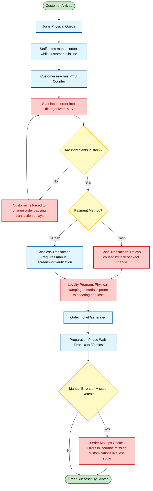

# Current Operations Process (Jayd's Cafe)

Based on the interview transcript provided, here is the visual representation of the **Current Process** at Jayd's Cafe. 

The flowchart specifically highlights the operational bottlenecks (in red) that currently cause delays, errors, and inefficiencies during peak hours (2:00 PM - 4:00 PM and 6:00 PM - 10:00 PM). This diagram is designed to be directly inserted into **Chapter 1: Project Context** of your thesis to justify the need for CafeOS.

### Key Bottlenecks Identified in the Current Flow:
1. **Disorganized POS & Stock Blindness**: Cashiers are often unaware of ingredient shortages until the order is being punched in, forcing the customer to change their order on the spot and holding up the line.
2. **Payment Inefficiencies**: Cash payments cause delays due to a lack of change/coins at the register. Cashless payments currently rely on manual screenshot verifications.
3. **Manual Relay Errors**: Because of manual order taking and lack of strict customization tracking, baristas often mix up details like Hot vs. Iced or specific requests like "less sugar".
4. **Vulnerable Loyalty System**: Physical stamp cards are inefficient and highly susceptible to cheating/copying.
