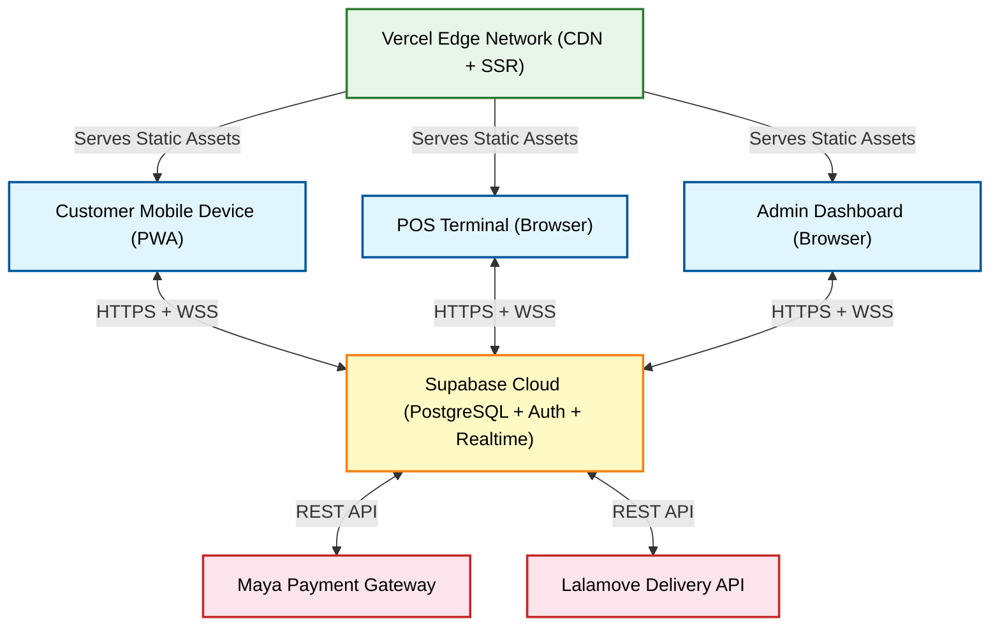
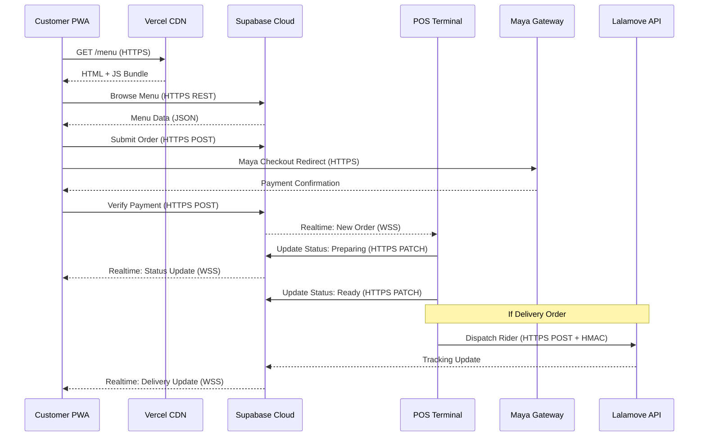

# CafeOS Network Topology & Network Model

All information below is derived directly from the codebase (`.env.example`, `maya.ts`, `supabase/client.ts`, `useOrders.ts`, `useNotifications.ts`, `dashboard/page.tsx`, Lalamove dispatch routes, and `manifest.json`).

---

## 1. Network Topology

### Topology Type: **Star Topology (Cloud-Centric)**

CafeOS uses a **cloud-centric star topology** where all client nodes communicate through a central cloud hub. There is **no direct peer-to-peer communication** between endpoints. Every device (customer phone, POS terminal, admin laptop) connects to the same central Supabase backend over the public internet via HTTPS and WebSocket.

### Network Nodes

| Node | Role | Device | Connection |
|---|---|---|---|
| **Customer PWA** | End-user ordering interface | Mobile phone / Tablet | Wi-Fi or Mobile Data (4G/5G) |
| **POS Terminal** | Staff ordering and dashboard | Tablet / Laptop in-store | Cafe Wi-Fi (LAN) |
| **Admin Dashboard** | Business management portal | Laptop / Desktop | Any internet connection |
| **Supabase Cloud** | Central backend (Database, Auth, Realtime) | Cloud server (AWS ap-southeast-1) | Public internet |
| **Vercel Edge** | Frontend hosting and CDN | Edge server (global CDN) | Public internet |

### External Service Endpoints

| Service | Base URL (from codebase) | Purpose | Protocol |
|---|---|---|---|
| **Supabase** | `https://segzigvrcgxdjskfltju.supabase.co` | Database, Auth, Realtime WebSocket | HTTPS + WSS |
| **Maya Sandbox** | `https://pg-sandbox.paymaya.com` | E-wallet checkout and payment verification | HTTPS (REST) |
| **Maya Production** | `https://pg.paymaya.com` | Production payment processing | HTTPS (REST) |
| **Lalamove Sandbox** | `https://rest.sandbox.lalamove.com` | Delivery quotation and order dispatch | HTTPS (REST + HMAC-SHA256) |

---

## 2. Network Model

### Applicable Model: **TCP/IP Model (Internet Model)**

CafeOS operates entirely over the public internet using standard web protocols. The TCP/IP model is the most applicable framework for describing the system's network communication.

### Layer Mapping

| TCP/IP Layer | OSI Equivalent | CafeOS Implementation |
|---|---|---|
| **Application Layer** | Application, Presentation, Session | Next.js (React SSR/CSR), Supabase JS Client, Maya REST API, Lalamove REST API, PWA Manifest |
| **Transport Layer** | Transport | **TCP** for all HTTPS requests; **TCP + WebSocket (WSS)** for Supabase Realtime channels |
| **Internet Layer** | Network | **IPv4/IPv6** routing over public internet via ISP and cloud provider networks |
| **Network Access Layer** | Data Link, Physical | **Wi-Fi (802.11)** for POS and in-store devices; **4G/5G cellular** for customer mobile devices |

### Communication Protocols Used

| Protocol | Where Used | Description |
|---|---|---|
| **HTTPS (TLS 1.3)** | All client ↔ Supabase, All client ↔ Vercel, Server ↔ Maya, Server ↔ Lalamove | Encrypted HTTP for REST API calls, page serving, and authentication |
| **WSS (WebSocket Secure)** | POS Dashboard, Customer Order Tracking, Notifications | Persistent bidirectional connection for realtime order status updates via Supabase Realtime channels (rate-limited to 10 events/sec as configured in `client.ts`) |
| **HMAC-SHA256** | Server ↔ Lalamove API, Maya Webhook Verification | Request signing for API authentication and webhook payload integrity verification |
| **DNS** | All nodes | Domain name resolution for `*.supabase.co`, `*.paymaya.com`, `*.lalamove.com`, and Vercel domains |

### Data Flow Summary

### Key Architectural Characteristics

1. **Serverless**: No self-hosted backend servers. All server-side logic runs as Vercel Serverless Functions (Next.js API Routes).
2. **Cloud-Native**: The database, authentication, and realtime engine are fully managed by Supabase (hosted on AWS).
3. **PWA**: The Customer app is a Progressive Web App (`display: standalone` in `manifest.json`) that can be installed on mobile devices and works offline for cached content.
4. **Realtime**: Supabase Realtime uses WebSocket (WSS) channels for live order tracking, notifications, and POS dashboard updates — configured at 10 events/second.
5. **Zero Trust**: All API calls are authenticated via JWT (Supabase Auth) or API key (Maya/Lalamove). Row-Level Security (RLS) enforces data access at the database level.
