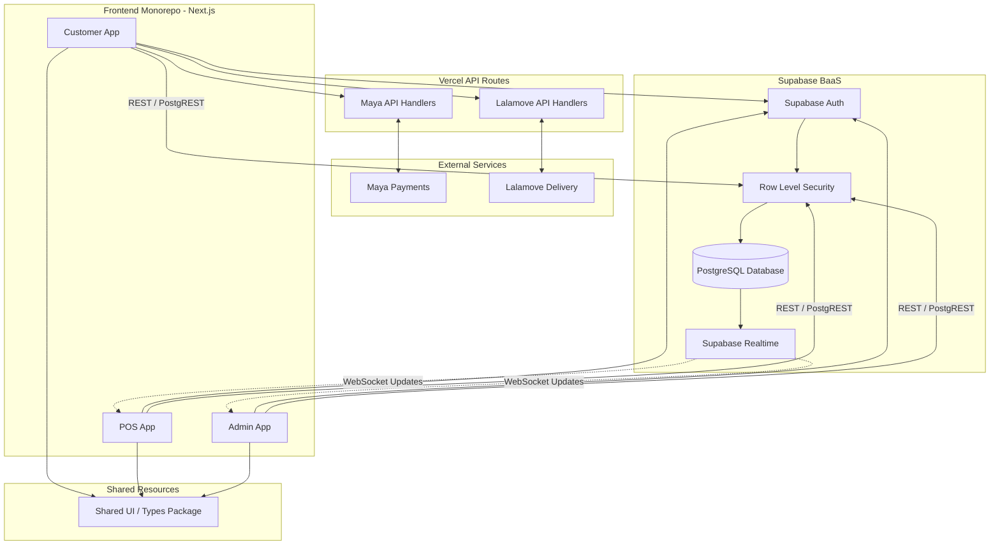

# CafeOS System Architecture

CafeOS utilizes a modern, serverless **Monorepo architecture**. It separates concerns into distinct frontend applications while sharing a single, unified database and backend-as-a-service (BaaS) provider.

## 1. Frontend Layer (Client Applications)
The frontend is built using **Next.js 14 (App Router)** and organized as an NPM Workspace monorepo. It consists of three independent applications:
* **Customer App**: A mobile-first Progressive Web App (PWA) where customers browse the menu, apply vouchers, and place delivery or dine-in orders.
* **POS App**: A tablet-optimized Point-of-Sale interface for staff to punch in walk-in orders, manage the Kitchen Display System (KDS), and process authorized void transactions.
* **Admin App**: A desktop dashboard for management to oversee inventory, edit the catalog, configure vouchers, and view sales analytics.
* **Shared Package (`@cafeos/shared`)**: A library of reusable React components, utility functions, and TypeScript interfaces shared across all three applications to maintain consistency.

## 2. Backend & Database Layer (Supabase BaaS)
Instead of a traditional monolithic Node.js server, CafeOS leverages **Supabase** for backend operations:
* **PostgreSQL Database**: The core relational database storing all structured data (users, orders, inventory, etc.).
* **Supabase Auth**: Manages user registration, login, and secure session tokens.
* **Row Level Security (RLS)**: Enforces security policies directly at the database level. It ensures customers can only read/write their own orders, while staff have elevated access based on the `role` in their profile.
* **Supabase Realtime**: Uses WebSockets to instantly broadcast database changes. For example, when a customer places an order, the POS app receives the new order on the KDS instantly without refreshing the page.

## 3. Integration & API Layer (Next.js Serverless Functions)
For secure operations that cannot be exposed to the browser, CafeOS uses Next.js server-side API routes (`/api/*`):
* **Maya Payments**: Handles secure checkout token generation and listens to webhooks from Maya to confirm when a customer successfully pays.
* **Lalamove API**: Handles fetching real-time delivery quotations based on coordinates and automatically dispatches riders when delivery orders are marked as ready.

## 4. Hosting & Deployment (Vercel)
The applications are deployed on **Vercel's Edge Network**. 
* Each application (Customer, POS, Admin) is deployed as a separate Vercel Project linked to the same GitHub repository. 
* This allows each app to scale independently while taking advantage of Vercel's automatic caching, static generation, and serverless compute for API routes.

---

## System Architecture Diagram

