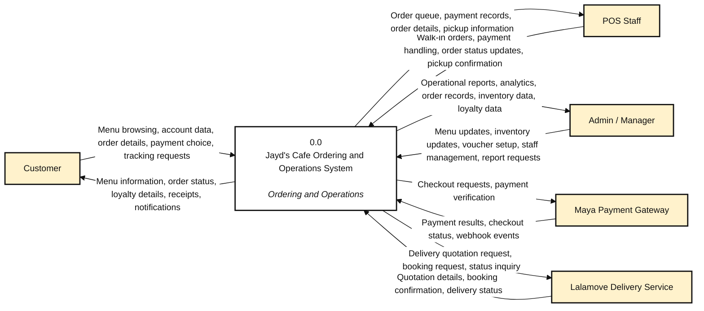
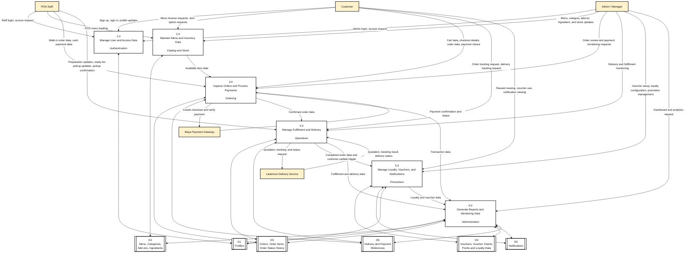

# Jayd's Cafe System DFD

This document contains the thesis-safe **Data Flow Diagram Level 0 and Level 1** for the current Jayd's Cafe system.

- **DFD Level 0** presents the system as one major process and shows its interaction with external entities.
- **DFD Level 1** decomposes the system into its major internal processes and shared data stores.

These diagrams are based on the implemented system in the repo: customer ordering, POS operations, admin management, Maya payment handling, Lalamove delivery support, loyalty, vouchers, and reporting.

## DFD Level 0

## DFD Level 1

## Process Summary

- **1.0 User and Access Management**
  Handles customer, staff, and admin authentication, profile maintenance, and role-based access.

- **2.0 Menu and Inventory Management**
  Handles menu item maintenance, categories, add-ons, ingredients, and stock availability.

- **3.0 Order and Payment Processing**
  Handles cart data, order creation, payment handling, and Maya-based payment verification.

- **4.0 Fulfillment and Delivery Management**
  Handles order preparation, order status progression, pickup confirmation, and Lalamove-linked delivery processing.

- **5.0 Loyalty, Voucher, and Notification Management**
  Handles points, rewards, voucher usage, promotional support, and customer notifications.

- **6.0 Reporting and Administrative Monitoring**
  Handles dashboards, order monitoring, inventory visibility, and operational reporting for management.

## Data Store Summary

- **D1 Profiles**
  Stores user identity and role information for customers, staff, and admins.

- **D2 Menu, Categories, Add-ons, Ingredients**
  Stores menu catalog data and stock-related records used in ordering and inventory management.

- **D3 Orders, Order Items, Order Status History**
  Stores the main transaction records and status progression of orders.

- **D4 Vouchers, Voucher Claims, Points and Loyalty Data**
  Stores promotional and loyalty-related information.

- **D5 Notifications**
  Stores customer-facing and system-generated notification records.

- **D6 Delivery and Payment References**
  Stores payment reference data and delivery-related identifiers such as Maya and Lalamove references.

## Recommended Thesis Label

For the manuscript or presentation, the safest label is:

**Figure X. Data Flow Diagram Level 0 of the Proposed Jayd's Cafe Ordering and Operations System**  
**Figure Y. Data Flow Diagram Level 1 of the Proposed Jayd's Cafe Ordering and Operations System**
