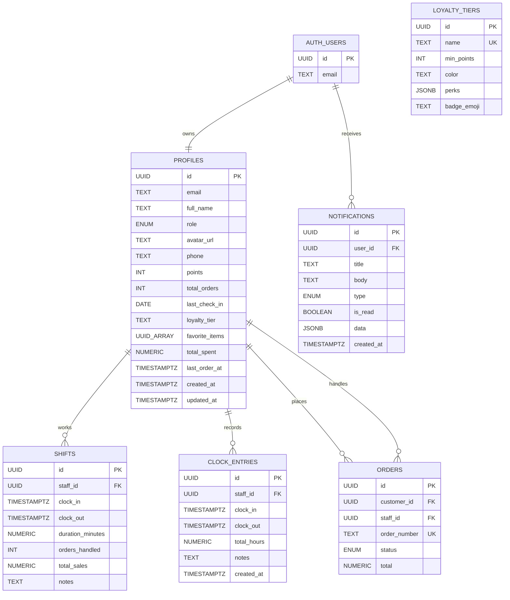
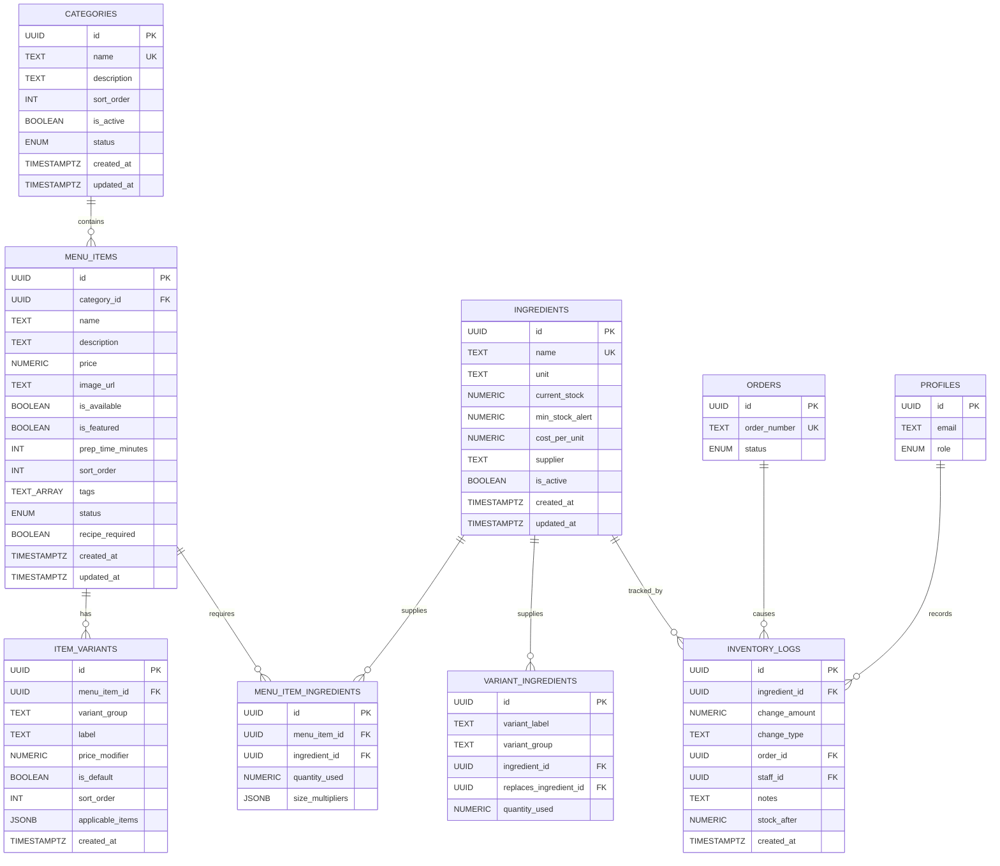
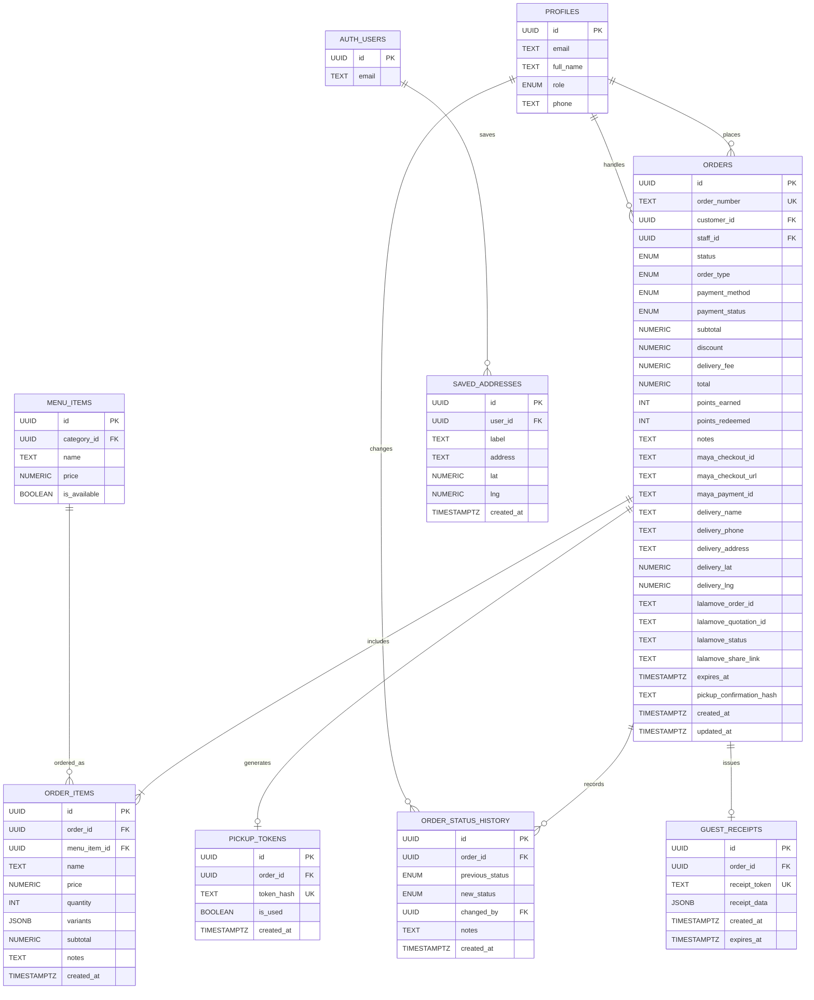
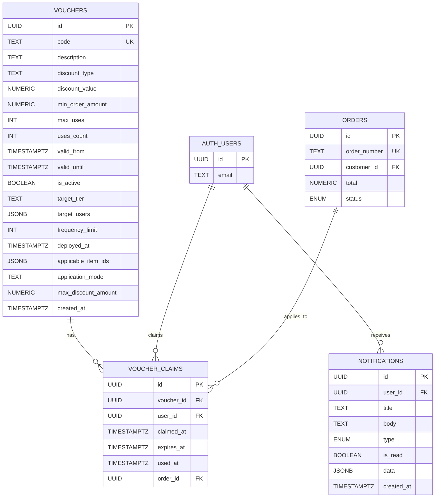
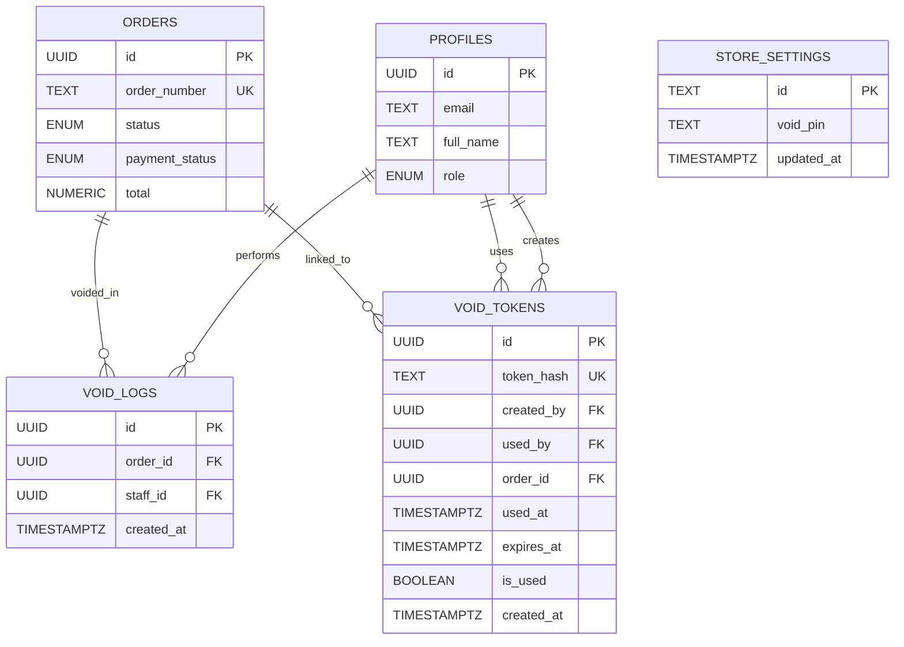

# Jayd's Cafe System Entity Relationship Diagrams

This document contains wide-scope ERDs for the proposed Jayd's Cafe Ordering and Operations System. The diagrams are based on the actual Supabase schema and migration files in this repository.

Recommended use in the manuscript:

- Use **Figure 1. Overall Entity Relationship Diagram of the Proposed System** as the high-level ERD.
- Use the module ERDs as supporting figures when the adviser/panel asks for clearer breakdowns.
- Use the notes at the end to explain JSONB and text-based relationships that are intentional implementation choices.

## Figure 1. Overall Entity Relationship Diagram of the Proposed System

```mermaid
erDiagram
    AUTH_USERS ||--|| PROFILES : owns
    AUTH_USERS ||--o{ SAVED_ADDRESSES : stores
    AUTH_USERS ||--o{ NOTIFICATIONS : receives
    AUTH_USERS ||--o{ VOUCHER_CLAIMS : claims

    PROFILES ||--o{ ORDERS : places
    PROFILES ||--o{ ORDERS : handles
    PROFILES ||--o{ ORDER_STATUS_HISTORY : changes
    PROFILES ||--o{ INVENTORY_LOGS : records
    PROFILES ||--o{ SHIFTS : works
    PROFILES ||--o{ CLOCK_ENTRIES : logs
    PROFILES ||--o{ VOID_LOGS : voids
    PROFILES ||--o{ VOID_TOKENS : creates_or_uses

    CATEGORIES ||--o{ MENU_ITEMS : contains
    MENU_ITEMS ||--o{ ITEM_VARIANTS : has
    MENU_ITEMS ||--o{ ORDER_ITEMS : ordered_as
    MENU_ITEMS ||--o{ MENU_ITEM_INGREDIENTS : requires

    INGREDIENTS ||--o{ MENU_ITEM_INGREDIENTS : used_by
    INGREDIENTS ||--o{ VARIANT_INGREDIENTS : modifies
    INGREDIENTS ||--o{ INVENTORY_LOGS : tracked_in

    ORDERS ||--|{ ORDER_ITEMS : includes
    ORDERS ||--o{ ORDER_STATUS_HISTORY : records
    ORDERS ||--o{ INVENTORY_LOGS : deducts
    ORDERS ||--o| PICKUP_TOKENS : generates
    ORDERS ||--o| GUEST_RECEIPTS : issues
    ORDERS ||--o{ VOUCHER_CLAIMS : uses
    ORDERS ||--o{ VOID_LOGS : audited_by
    ORDERS ||--o{ VOID_TOKENS : linked_to

    VOUCHERS ||--o{ VOUCHER_CLAIMS : claimed_as

    AUTH_USERS {
        UUID id PK
        TEXT email
    }

    PROFILES {
        UUID id PK
        TEXT email
        TEXT full_name
        ENUM role
        TEXT phone
        INT points
        INT total_orders
        TEXT loyalty_tier
        NUMERIC total_spent
    }

    CATEGORIES {
        UUID id PK
        TEXT name UK
        INT sort_order
        BOOLEAN is_active
        ENUM status
    }

    MENU_ITEMS {
        UUID id PK
        UUID category_id FK
        TEXT name
        NUMERIC price
        BOOLEAN is_available
        INT prep_time_minutes
        ENUM status
        BOOLEAN recipe_required
    }

    ITEM_VARIANTS {
        UUID id PK
        UUID menu_item_id FK
        TEXT variant_group
        TEXT label
        NUMERIC price_modifier
        BOOLEAN is_default
        JSONB applicable_items
    }

    INGREDIENTS {
        UUID id PK
        TEXT name UK
        TEXT unit
        NUMERIC current_stock
        NUMERIC min_stock_alert
        NUMERIC cost_per_unit
    }

    MENU_ITEM_INGREDIENTS {
        UUID id PK
        UUID menu_item_id FK
        UUID ingredient_id FK
        NUMERIC quantity_used
        JSONB size_multipliers
    }

    VARIANT_INGREDIENTS {
        UUID id PK
        TEXT variant_label
        TEXT variant_group
        UUID ingredient_id FK
        UUID replaces_ingredient_id FK
        NUMERIC quantity_used
    }

    ORDERS {
        UUID id PK
        TEXT order_number UK
        UUID customer_id FK
        UUID staff_id FK
        ENUM status
        ENUM order_type
        ENUM payment_method
        ENUM payment_status
        NUMERIC subtotal
        NUMERIC discount
        NUMERIC total
        INT points_earned
        INT points_redeemed
    }

    ORDER_ITEMS {
        UUID id PK
        UUID order_id FK
        UUID menu_item_id FK
        TEXT name
        NUMERIC price
        INT quantity
        JSONB variants
        NUMERIC subtotal
    }

    ORDER_STATUS_HISTORY {
        UUID id PK
        UUID order_id FK
        UUID changed_by FK
        ENUM previous_status
        ENUM new_status
        TEXT notes
    }

    INVENTORY_LOGS {
        UUID id PK
        UUID ingredient_id FK
        UUID order_id FK
        UUID staff_id FK
        NUMERIC change_amount
        TEXT change_type
        NUMERIC stock_after
    }

    VOUCHERS {
        UUID id PK
        TEXT code UK
        TEXT discount_type
        NUMERIC discount_value
        NUMERIC min_order_amount
        INT max_uses
        BOOLEAN is_active
    }

    VOUCHER_CLAIMS {
        UUID id PK
        UUID voucher_id FK
        UUID user_id FK
        UUID order_id FK
        TIMESTAMPTZ claimed_at
        TIMESTAMPTZ used_at
    }

    NOTIFICATIONS {
        UUID id PK
        UUID user_id FK
        TEXT title
        TEXT body
        ENUM type
        BOOLEAN is_read
        JSONB data
    }

    SAVED_ADDRESSES {
        UUID id PK
        UUID user_id FK
        TEXT label
        TEXT address
        NUMERIC lat
        NUMERIC lng
    }

    PICKUP_TOKENS {
        UUID id PK
        UUID order_id FK
        TEXT token_hash UK
        BOOLEAN is_used
    }

    GUEST_RECEIPTS {
        UUID id PK
        UUID order_id FK
        TEXT receipt_token UK
        JSONB receipt_data
        TIMESTAMPTZ expires_at
    }

    SHIFTS {
        UUID id PK
        UUID staff_id FK
        TIMESTAMPTZ clock_in
        TIMESTAMPTZ clock_out
        INT orders_handled
        NUMERIC total_sales
    }

    CLOCK_ENTRIES {
        UUID id PK
        UUID staff_id FK
        TIMESTAMPTZ clock_in
        TIMESTAMPTZ clock_out
        NUMERIC total_hours
    }

    VOID_LOGS {
        UUID id PK
        UUID order_id FK
        UUID staff_id FK
        TIMESTAMPTZ created_at
    }

    VOID_TOKENS {
        UUID id PK
        TEXT token_hash UK
        UUID created_by FK
        UUID used_by FK
        UUID order_id FK
        BOOLEAN is_used
    }

    STORE_SETTINGS {
        TEXT id PK
        TEXT void_pin
        TIMESTAMPTZ updated_at
    }
```

## Figure 2. User, Staff, Loyalty, and Notification ERD

Defense note: `profiles.loyalty_tier` is stored as a tier name string. It is conceptually aligned with `loyalty_tiers.name`, but the current database does not enforce it as a foreign key.

## Figure 3. Menu, Variants, and Inventory ERD

Defense note: `variant_ingredients` maps variant ingredient usage through `variant_label` and `variant_group`, not through a direct `item_variant_id` foreign key. This is workable for reusable add-ons, but a future normalization improvement would be adding `item_variant_id`.

## Figure 4. Ordering, Payment, Pickup, and Delivery ERD

Defense note: Maya and Lalamove are external services, so they are represented through reference fields in the `orders` table rather than local database tables.

## Figure 5. Vouchers, Claims, Promotions, and Notifications ERD

Defense note: `vouchers.applicable_item_ids` and `vouchers.target_users` are JSONB configuration fields. They support flexible voucher targeting, but they are not enforced as foreign keys in the current database design.

## Figure 6. Admin, Void, and Audit ERD

Defense note: `store_settings` stores global configuration such as the void PIN. It has no child table because it represents a single global settings record.

## Relationship Notes for Defense

- `auth.users` is a Supabase authentication table. The local application table is `profiles`, which stores role, loyalty, contact, and user-facing profile data.
- `orders.customer_id` and `orders.staff_id` both reference `profiles.id`. This is why the same table appears twice conceptually: one user can be a customer, while another can be the staff member handling the order.
- `order_items` stores `name`, `price`, and `variants` as snapshots. This preserves historical order accuracy even if menu prices or variant definitions change later.
- `menu_item_ingredients` is the main recipe bridge table between menu items and ingredients.
- `inventory_logs` records stock movement and can optionally connect stock changes to an order and staff member.
- `pickup_tokens` and `guest_receipts` support pickup verification and receipt access without changing the main order structure.
- `voucher_claims` tracks which users claimed or used a voucher, while the voucher rules remain in `vouchers`.
- `notifications` supports user-specific and broadcast notifications. A `NULL` user target means the notification can be treated as broadcast/system-level.
- `saved_addresses.user_id`, `notifications.user_id`, and `voucher_claims.user_id` reference `auth.users`. In the application, these users are also represented by `profiles`.

## Scope Control for the Manuscript

For Chapter 3, avoid showing all six diagrams unless the adviser asks for a complete appendix-style set. A clean manuscript structure would be:

1. Overall ERD
2. Menu and Inventory ERD
3. Ordering, Payment, Pickup, and Delivery ERD
4. Vouchers, Promotions, and Notifications ERD

The User/Staff and Admin/Audit ERDs can be placed in an appendix or included only if the panel asks for more detail.
